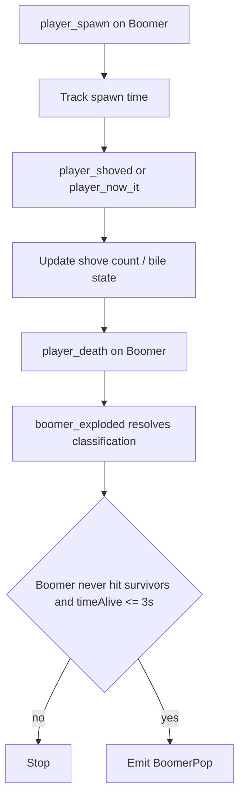
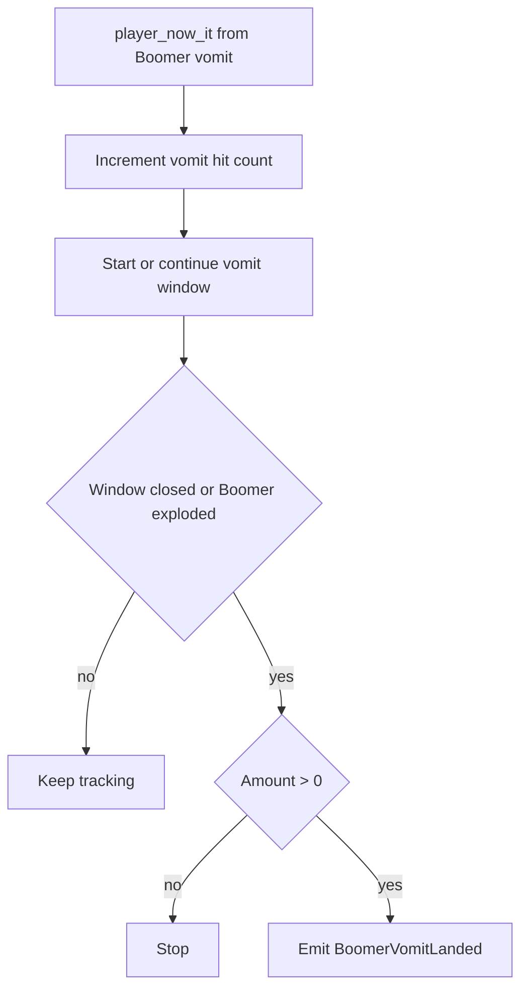

# Boomer Flows

Este documento resume los flujos actuales de skills relacionadas con `Boomer`.

## Skills

- `BoomerPop`
- `BoomerVomitLanded`

## BoomerPop

### Sources

- `player_spawn`
- `player_shoved`
- `player_now_it`
- `boomer_exploded`
- `player_death`

### State

- `g_DetectBoomer.spawnTime`
- `g_DetectBoomer.hitSomebody`
- `g_DetectBoomer.shoveCount`

### Emit

Se emite `BoomerPop` cuando:

- el `Boomer` muere,
- no logró vomitar ni explotar sobre survivors,
- y la kill final viene del survivor que lo poppeó.

### Properties

- `shove_count`
- `time_a`

### Flow

## BoomerVomitLanded

### Sources

- `player_now_it`
- `boomer_exploded`
- timer de cierre de ventana de vomit

### State

- `g_DetectBoomer.vomitHits`

Ventana:

- `L4D2_SKILLS_BOOMER_VOMIT_WINDOW`

### Emit

Se emite `BoomerVomitLanded` cuando:

- el `Boomer` conecta vomit directo,
- el detector acumula la cantidad de survivors afectados,
- y la ventana de vomit se cierra con al menos un impacto válido.

No se usa para explosión del `Boomer`; solo para vomit directo.

### Properties

- `amount`

### Flow

## Prioridad con BoomerKill

La muerte genérica es provisional: los 100 ms son una espera mínima, no una
resolución de prioridad. Si Pop todavía podría calificar, el timer conserva el
candidato y los tracks hasta que `boomer_exploded` resuelva la clasificación o
hasta observar `timeAlive > L4D2_SKILLS_COMPETITIVE_POP_MAX_TIME` (3 s desde spawn).
En el empate exacto de 3 s aún puede ganar Pop; el timer vuelve a comprobar el
límite estricto. No se amplía la ventana de aceptación de Pop.

Un Pop válido, incluso posterior a 100 ms y con `Plugin_Handled`, cancela el kill
antes de su forward. Una explosión con bile, impactos previos, atacante inválido
o fuera de ventana resuelve noPop: si los 100 ms ya vencieron, publica el kill;
si no, espera el timer. Sin explosión, un spawn conocido permite el fallback
cuando Pop ya no puede calificar. Un spawn desconocido (`spawnTime <= 0`) conserva
la regla previa `timeAlive=0`: espera la señal o se descarta al invalidarse la
vida/ronda/mapa, sin inventar una fecha límite.

La resolución se reserva por vida antes de los callbacks públicos. Duplicados y
reentradas no publican la misma muerte dos veces. Kill conserva `LifeKill`; Pop
conserva la proyección de asistencias `SkillWindow`. Userid, generación de vida,
ronda e ID del candidato protegen el timer; el dispatch también valida el epoch
de lifecycle. Un nuevo spawn resetea la resolución, incluso con Skills desactivado.

Este ajuste fue autorizado durante el refactor. El baseline enviaba el forward
de kill antes de decidir Pop; únicamente difería el anuncio. La
[validación local](l4d2-skills-boomer-late.md) resuelve el borde posterior a 100 ms;
la entrega real de eventos permanece en el [smoke pendiente](l4d2-skills-srcds-smoke.md).
